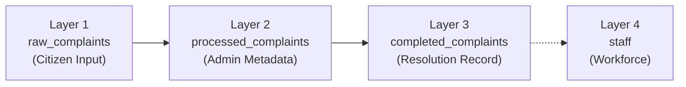

# OneServe V2 — Feature Expansion Implementation Plan (Revised)

## Goal
Add 12 major features to OneServe while keeping the existing platform fully functional. Each phase is self-contained and non-breaking.

---

## Current Architecture Summary

| Layer | What Exists |
|---|---|
| **Auth** | Supabase Auth → `profiles` (citizen/admin) → `citizens` extension table |
| **Complaints** | 3-layer: `raw_complaints` → `processed_complaints` → `staff` |
| **Frontend** | React 18 + Vite + Tailwind 4 + React Router 6 |
| **Backend** | Vercel serverless (`/api/send-email.js`), local Node/Express dev server |
| **Roles** | `citizen` and `admin` only — no `worker` role exists yet |
| **Supabase** | Free tier (no `pg_cron`) |

---

## Architectural Change: 4-Layer Complaint System

Based on your feedback, we're extending the existing 3-layer system to a clean **4-layer architecture**:



| Layer | Table | Purpose | Written By |
|---|---|---|---|
| **Layer 1** | `raw_complaints` | Original citizen submission (write-once) | Citizen |
| **Layer 2** | `processed_complaints` | Priority, status, assignment metadata | Admin/System |
| **Layer 3 (NEW)** | `completed_complaints` | Resolution details: worker info, completion image, rating, timestamps | Worker/System |
| **Layer 4** | `staff` | Workforce availability and performance | Admin |

> [!TIP]
> **Why a separate table?** Layer 2 tracks the *lifecycle* of a complaint (assigned, in-progress). Layer 3 is the *permanent resolution record* — it's created once on completion and never modified (except for citizen rating). This keeps Layer 2 lean and auditable, and Layer 3 becomes a clean source of truth for analytics, worker performance, and ETA calculations.

### `completed_complaints` Schema

| Column | Type | Description |
|---|---|---|
| `id` | uuid | PK, FK → `raw_complaints.id` |
| `worker_id` | uuid | FK → `staff.id` — who resolved it |
| `completion_image_url` | text | Mandatory photo proof of resolution |
| `resolution_notes` | text | Optional worker notes |
| `completed_at` | timestamptz | When the worker marked it done |
| `time_to_resolve_minutes` | integer | Computed: `completed_at - assigned_at` |
| `rating` | integer (1–5) | Citizen's rating (null until rated) |
| `rating_feedback` | text | Optional citizen comment |
| `rated_at` | timestamptz | When citizen submitted rating |

---

## Realistic ETA System (Redesigned)

Based on your feedback, the ETA is **not** a simple speed×distance calculation. Instead:

### How ETA is Computed

```
ETA = now
    + (worker's current queue × avg_completion_time_per_task)
    + travel_offset_for_distance
```

**Inputs:**
1. **Historical average completion time** — Queried from `completed_complaints.time_to_resolve_minutes` for that specific worker. Falls back to a global average if worker has <3 completed tasks.
2. **Current queue depth** — Count of tasks assigned to worker that are not yet resolved.
3. **Distance offset** — Travel time estimate from worker's last known location to the complaint location (at 25 km/h city average), but this is added as a minor adjustment, not the primary factor.

**Output format:**
- `"Friday, April 25 at ~2:00 PM"` (calendar-aware, rounded to nearest 30 min)
- Falls back to `"Within 2–3 business days"` if insufficient historical data

**Where it appears:**
- In the assignment confirmation email to the citizen
- In the ManpowerModal before admin confirms assignment (preview)
- In the citizen's complaint tracking detail view

---

## Worker Onboarding — Option Comparison

| Factor | **A) Invite Code** | **B) Admin Creates Account** | **C) Worker Self-Signup** |
|---|---|---|---|
| **Security** | ✅ High — code validates worker identity | ⚠️ Medium — admin shares credentials | ❌ Low — anyone can claim worker role |
| **Admin Effort** | Medium — generates code, gives to worker | High — creates account + shares creds | Low — but must manually verify later |
| **Worker Experience** | ✅ Good — they own their own credentials | ❌ Bad — using someone else's password | ✅ Good — normal signup flow |
| **Password Safety** | ✅ Worker sets own password | ❌ Admin knows the password initially | ✅ Worker sets own password |
| **Scalability** | ✅ Works for many workers | ❌ Bottleneck on admin | ⚠️ Requires manual linking step |
| **Prevents Impersonation** | ✅ Code is single-use, tied to staff record | ✅ Admin controls everything | ❌ No — someone could fake the role |
| **Implementation Complexity** | Medium | Low | Medium |

### Recommendation: **Option A (Invite Code)**

**How it works:**
1. Admin creates a staff record (already works today in your system)
2. System generates a unique, single-use invite code (stored in `staff.invite_code`)
3. Admin gives the code to the worker (verbally, SMS, etc.)
4. Worker goes to signup page → enters code → system links their new `auth.users` account to the existing `staff` record
5. Code is consumed (set to null) — cannot be reused

**Why A wins:**
- Worker owns their credentials (no password sharing)
- Admin controls who becomes a worker (no impersonation)
- Single-use code prevents reuse/abuse
- Clean separation of admin and worker responsibilities

> [!IMPORTANT]
> **Please confirm Option A** or specify a different preference so I can implement accordingly.

---

## User Review Required

> [!IMPORTANT]
> **New `worker` role**: Workers log into the same app but see a **completely different dashboard**. Their auth flow uses the existing `staff` table, linked to a new `auth.users` account via invite code (Option A).

> [!WARNING]
> **Database migrations**: Phases 1–6 each require SQL migrations run in Supabase SQL Editor. All are incremental and non-destructive (no columns dropped, only added). I will provide ready-to-run SQL files.

> [!IMPORTANT]
> **Priority escalation without pg_cron**: Since you're on the free tier, escalation will run as an on-login check. Every time an admin opens the dashboard, a lightweight RPC scans for stale complaints and bumps their priority. This means escalation only happens when an admin is active, not at exact 24/48/72 hour marks — but it's the best approach without cron.

---

## PostGIS Check

Run this query in your **Supabase Dashboard → SQL Editor**:

```sql
SELECT * FROM pg_extension WHERE extname = 'postgis';
```

- **If a row is returned** → PostGIS is enabled ✅ (I'll use `ST_DWithin` for nearest-task queries)
- **If empty** → Run `CREATE EXTENSION IF NOT EXISTS postgis;` (Supabase free tier supports it)
- **If that fails** → I'll use Haversine formula in application code instead (slightly less efficient but works)

> [!IMPORTANT]
> **Please run this check and let me know the result**, or just try enabling it with the `CREATE EXTENSION` command above.

---

## Proposed Changes

Organized into **6 incremental phases**, each deployable independently.

---

### Phase 1: Worker Module + Worker State Management (Items 1, 9)

Foundational phase. Adds workers as first-class users with the 4th database layer.

---

#### [NEW] `migrations/v7_worker_module.sql`

**Changes to `staff` table:**
- Add `email` (text) — worker's email for login
- Add `auth_user_id` (uuid, nullable) — FK to `auth.users`
- Add `invite_code` (text, nullable, unique) — single-use signup code
- Add `shift_start` (time, default '09:00') — shift begins
- Add `shift_end` (time, default '18:00') — shift ends
- Add `assignment_radius_km` (integer, default 5) — max task distance

**New table: `completed_complaints`**
- Schema as described in the architecture section above
- FK constraints to `raw_complaints`, `staff`
- Index on `worker_id` for performance queries
- Index on `completed_at` for ETA average calculations

**New RPCs:**
- `worker_complete_task(p_complaint_id, p_image_url, p_notes)`:
  - Validates caller is the assigned worker
  - Creates `completed_complaints` record with computed `time_to_resolve_minutes`
  - Updates `processed_complaints.complaint_status` → `'resolved'`
  - Sets `staff.status` → `'available'`, clears `current_assignment_id`
  - Increments `staff.complaints_handled`
- `auto_assign_nearest_task(p_worker_id)`:
  - Finds nearest unassigned complaint within `assignment_radius_km`
  - Only assigns during worker's shift hours (between `shift_start` and `shift_end`)
  - Updates `staff.status` → `'busy'`, sets `current_assignment_id`
  - Returns the assigned complaint (or null if none found)
- `worker_signup_with_code(p_invite_code)`:
  - Validates invite code exists and is unused
  - Links `auth.uid()` to `staff.auth_user_id`
  - Creates `profiles` entry with `role = 'worker'`
  - Consumes the invite code (sets to null)

**RLS policies:**
- Workers can SELECT their own `staff` record
- Workers can SELECT complaints where `staff.current_assignment_id` matches
- Workers can call `worker_complete_task` only for their assigned complaint

**Changes to `profiles`:**
- Add `'worker'` as accepted value for the `role` column

---

#### [NEW] `src/app/components/modules/WorkerDashboard.tsx`

Worker's single-screen interface:

**When task is assigned (busy state):**
- Task card showing: title, description, category, priority badge
- Location section with "📍 Open in Google Maps" button
- Citizen contact info (if available)
- **"Mark as Complete"** button (prominent, green)
  - Opens modal requiring:
    - 📷 Image upload (mandatory — photo of resolved issue)
    - 📝 Optional resolution notes
  - On submit → calls `worker_complete_task` RPC
  - Success animation → auto-calls `auto_assign_nearest_task`
  - If new task found → loads it; if not → switches to free state

**When no task (free state):**
- "No tasks assigned" empty state with illustration
- "Check for nearby tasks" button → manually calls `auto_assign_nearest_task`
- Worker info card (name, zone, rating, total completed)

**Worker controls:**
- Availability toggle: "Available" ↔ "Off Duty"
- Task history accordion (past completed tasks from `completed_complaints`)

---

#### [MODIFY] [AuthContext.tsx](file:///c:/Users/kunal/Downloads/temp%20download/DTI%20V1/DTI%20V1/src/context/AuthContext.tsx)
- Add `'worker'` to `UserRole` type union
- Handle `role === 'worker'` in profile fetch logic (fetch `staff` record instead of `citizens`)
- Expose `staffProfile` in context when user is a worker

#### [MODIFY] [App.tsx](file:///c:/Users/kunal/Downloads/temp%20download/DTI%20V1/DTI%20V1/src/app/App.tsx)
- Add `/worker` route → `WorkerDashboard` (protected, `role === 'worker'` only)
- Redirect workers to `/worker` on login (not `/dashboard`)
- Add worker signup route `/signup/worker`

#### [MODIFY] [Sidebar.tsx](file:///c:/Users/kunal/Downloads/temp%20download/DTI%20V1/DTI%20V1/src/app/components/Sidebar.tsx)
- Add worker-specific nav items: `[Worker Dashboard, Task History, Settings]`
- Three-way role check: `isAdmin ? adminItems : role === 'worker' ? workerItems : citizenItems`

#### [MODIFY] [LoginPage.tsx](file:///c:/Users/kunal/Downloads/temp%20download/DTI%20V1/DTI%20V1/src/app/pages/auth/LoginPage.tsx)
- Add "Worker" as a third role option in the role selector grid
- Route workers to `/worker` on successful login

#### [NEW] `src/app/pages/auth/WorkerSignupPage.tsx`
- Invite code input field
- Basic name/email/password fields
- On submit: creates `auth.users` account → calls `worker_signup_with_code` RPC
- Navigates to `/worker` on success

#### [NEW] `src/lib/geo.ts`
- `getDistanceKm(lat1, lon1, lat2, lon2)` — Haversine formula
- `getGoogleMapsUrl(lat, lon)` — returns `https://www.google.com/maps?q=lat,lon`
- `getGoogleMapsDirectionsUrl(fromLat, fromLon, toLat, toLon)` — navigation link

---

### Phase 2: Citizen Rating System (Item 2)

Ratings are stored in Layer 3 (`completed_complaints`) — not a separate table.

---

#### [NEW] `migrations/v8_ratings.sql`

- Create RPC `submit_rating(p_complaint_id, p_rating, p_feedback)`:
  - Validates: complaint is resolved, caller is the original citizen, rating is 1–5
  - Validates: `completed_complaints.rating IS NULL` (one rating per complaint)
  - Sets `rating`, `rating_feedback`, `rated_at` on `completed_complaints`
  - Recalculates `staff.performance_rating` as weighted average across all their `completed_complaints`
  - `editable_until` check: allow edits only within 48h of rating submission (optional)
- RLS: citizens can only rate complaints where `raw_complaints.user_id = auth.uid()`

---

#### [NEW] `src/app/components/modules/RatingPopup.tsx`
- Modal dialog that checks for resolved-but-unrated complaints on citizen login
- Shows complaint summary (ref ID, category, worker name)
- Interactive 1–5 star selector with hover effects
- Optional text feedback field
- Submit → calls `submit_rating` RPC → success toast → dismisses
- "Remind me later" dismiss option (stores in localStorage to suppress for 24h)

#### [MODIFY] [Dashboard.tsx](file:///c:/Users/kunal/Downloads/temp%20download/DTI%20V1/DTI%20V1/src/app/components/Dashboard.tsx)
- On mount (citizen only): query `completed_complaints` where `rating IS NULL` and `citizen_id = user.id`
- If results found → render `<RatingPopup />` overlay

---

### Phase 3: Signup Enhancements + Document Verification (Items 3, 6)

---

#### [NEW] `migrations/v9_special_roles.sql`

- Create `user_documents` table:
  - `id` (uuid, PK, default `gen_random_uuid()`)
  - `user_id` (uuid, FK → `profiles.id`)
  - `document_type` (text: 'aadhaar', 'passport')
  - `document_url` (text — Supabase Storage URL)
  - `verification_status` (text: 'pending' | 'approved' | 'rejected', default 'pending')
  - `admin_notes` (text, nullable)
  - `created_at` (timestamptz, default now())
  - `reviewed_at` (timestamptz, nullable)
- Add `special_role` column to `profiles` (nullable text: 'policeman', 'doctor', 'fire_brigade', 'municipal_officer')
- Add `is_verified` boolean to `profiles` (default false)
- Create Supabase Storage bucket `documents` (private)
- RLS: users INSERT own docs; admins SELECT/UPDATE all

---

#### [MODIFY] [SignupPage.tsx](file:///c:/Users/kunal/Downloads/temp%20download/DTI%20V1/DTI%20V1/src/app/pages/auth/SignupPage.tsx)
- Add "Special Log-In" text button below email field (small, styled like "Forgot Password")
- Clicking it toggles an expandable section:
  - Role dropdown: Policeman, Doctor, Fire Brigade, Municipal Officer
  - Document upload (Aadhaar / Passport image)
  - Uploads file to `documents` storage bucket
  - Inserts into `user_documents` table
  - Sets `profiles.special_role` and `profiles.is_verified = false`
- Normal signup (without expanding) works exactly as before — zero friction for regular citizens

#### [NEW] `src/app/pages/admin/IDVerification.tsx`
- Table listing all `user_documents` with:
  - User name, email
  - Requested role
  - Document thumbnail (clickable to view full)
  - Status badge (pending/approved/rejected)
- Action buttons per row: ✅ Approve | ❌ Reject (with optional notes textarea)
- Approve sets `user_documents.verification_status = 'approved'` + `profiles.is_verified = true`
- Reject sets `verification_status = 'rejected'` + keeps `is_verified = false`
- Filter tabs: All | Pending | Approved | Rejected

#### [MODIFY] [Sidebar.tsx](file:///c:/Users/kunal/Downloads/temp%20download/DTI%20V1/DTI%20V1/src/app/components/Sidebar.tsx)
- Add "ID Verification" nav item in admin menu (with badge count of pending verifications)

#### [MODIFY] [App.tsx](file:///c:/Users/kunal/Downloads/temp%20download/DTI%20V1/DTI%20V1/src/app/App.tsx)
- Add `/id-verification` route → `IDVerification` (admin only)

---

### Phase 4: Priority System + Escalation (Item 4)

---

#### [NEW] `migrations/v10_priority_system.sql`

- Add `priority_level` to `processed_complaints` (text: 'low' | 'medium' | 'high' | 'critical', default 'low')
- Add `last_escalated_at` column (timestamptz, nullable)
- Create RPC `check_and_escalate_priorities()` (SECURITY DEFINER):
  - Scans all non-resolved complaints
  - `low` → `medium` : complaint age > 24h
  - `medium` → `high` : complaint age > 48h (from original creation, not last escalation)
  - `high` → `critical` : complaint age > 72h
  - Updates `last_escalated_at` on each escalation
  - Returns count of escalated complaints

**No pg_cron** → this RPC runs client-side when admin opens the dashboard.

---

#### [MODIFY] [ComplaintRegistration.tsx](file:///c:/Users/kunal/Downloads/temp%20download/DTI%20V1/DTI%20V1/src/app/components/modules/ComplaintRegistration.tsx)
- When inserting into `processed_complaints` (the simulated Layer 2 insert), compute initial `priority_level`:
  - Score 0–3 → `'low'`, 3–6 → `'medium'`, 6–8 → `'high'`, 8–10 → `'critical'`

#### [MODIFY] [AdminDashboard.tsx](file:///c:/Users/kunal/Downloads/temp%20download/DTI%20V1/DTI%20V1/src/app/components/modules/AdminDashboard.tsx)
- On mount: call `check_and_escalate_priorities()` RPC (silent, runs in background)
- Show `priority_level` badge on each complaint row (color-coded pill):
  - 🟢 Low | 🟡 Medium | 🟠 High | 🔴 Critical
- Default sort: Critical → High → Medium → Low
- Add `priority_level` to the filter dropdown (alongside existing priority score filter)
- Show toast notification if escalation found any bumped complaints: "⚠️ 3 complaints were escalated"

#### [MODIFY] [ManpowerModal.tsx](file:///c:/Users/kunal/Downloads/temp%20download/DTI%20V1/DTI%20V1/src/app/components/modules/ManpowerModal.tsx)
- Show priority level badge in the complaint context header within the modal

---

### Phase 5: Realistic ETA System (Item 5)

---

#### [NEW] `src/lib/eta.ts`

```typescript
interface ETAInput {
  workerId: string;
  workerLocation: { lat: number; lon: number } | null;
  taskLocation: { lat: number; lon: number } | null;
  currentQueueLength: number;  // tasks ahead of this one
}

interface ETAResult {
  estimatedDate: Date;
  formatted: string;       // "Thursday, April 24 at ~2:00 PM"
  confidence: 'high' | 'medium' | 'low';
  breakdown: {
    avgCompletionMinutes: number;
    queueDelayMinutes: number;
    travelOffsetMinutes: number;
  };
}
```

**Logic:**
1. Query `completed_complaints` WHERE `worker_id = workerId` → compute average `time_to_resolve_minutes`
2. If worker has < 3 completed tasks → use global average across all workers (medium confidence)
3. If no historical data at all → return `"Within 2–3 business days"` (low confidence)
4. `queueDelay = currentQueueLength × avgCompletionMinutes`
5. `travelOffset = distanceKm / 25 × 60` (25 km/h city speed → minutes)
6. `estimatedDate = now + queueDelay + travelOffset` (skip non-working hours)
7. Round to nearest 30 minutes
8. Format as: `"Thursday, April 24 at ~2:00 PM"`

**Business hours awareness:**
- If computed ETA falls outside shift hours (e.g., 9 PM) → push to next working day's shift start
- Skip Sundays (configurable)

---

#### [MODIFY] [ManpowerModal.tsx](file:///c:/Users/kunal/Downloads/temp%20download/DTI%20V1/DTI%20V1/src/app/components/modules/ManpowerModal.tsx)
- Replace hardcoded ETA strings with `calculateETA()` call when a staff member is selected
- Show ETA preview in the staff detail panel: `"Estimated resolution: Thursday, April 24 at ~2:00 PM"`
- Show confidence indicator (high/medium/low) as subtle badge
- Pass computed formatted ETA to `sendStaffAssignmentNotification()` email

#### [MODIFY] [notifications.ts](file:///c:/Users/kunal/Downloads/temp%20download/DTI%20V1/DTI%20V1/src/lib/notifications.ts)
- Update email template to display the calendar-formatted ETA
- Add confidence caveat: "This is an estimate based on historical data and may vary."

#### [MODIFY] [ComplaintTracking.tsx](file:///c:/Users/kunal/Downloads/temp%20download/DTI%20V1/DTI%20V1/src/app/components/modules/ComplaintTracking.tsx)
- In the complaint detail modal for "in_progress" complaints: show stored ETA from `processed_complaints`

---

### Phase 6: Admin Delete + Complaint UI + Legal Help + Cleanup (Items 7, 8, 10, 11, 12)

---

#### [NEW] `migrations/v11_admin_tools.sql`

- Create RPC `admin_hard_delete_complaint(p_complaint_id)` (SECURITY DEFINER):
  - Validates caller is admin
  - Deletes from `completed_complaints` (if exists)
  - Deletes from `processed_complaints`
  - Detaches any assigned worker (`staff.current_assignment_id = NULL, status = 'available'`)
  - Deletes complaint images from Supabase Storage
  - Deletes from `raw_complaints`
  - Full cascade — no orphan records

---

#### [MODIFY] [AdminDashboard.tsx](file:///c:/Users/kunal/Downloads/temp%20download/DTI%20V1/DTI%20V1/src/app/components/modules/AdminDashboard.tsx)
- Add red "🗑 Delete Complaint" button in the complaint detail modal
- Confirmation dialog (double-confirm pattern): "This will permanently delete this complaint and all related records. This cannot be undone."
- Calls `admin_hard_delete_complaint` RPC
- Removes from local state on success + success toast

#### [NEW] `src/app/components/modules/ComplaintsHub.tsx`
- Clean landing page with two action cards:
  - 📝 **"File a Complaint"** — description + "Get Started" button → `/complaint-registration`
  - 📋 **"Track Complaints"** — description + active count badge → `/complaint-tracking`
- Modern card design with icons and gradient backgrounds

#### [NEW] `src/app/pages/LegalHelpPage.tsx`
- Professional "Coming Soon" page (not a placeholder mock):
  - Icon header, brief description of what will be here
  - "We're building this feature. Stay tuned."
  - No broken buttons or fake UI

#### [MODIFY] [Sidebar.tsx](file:///c:/Users/kunal/Downloads/temp%20download/DTI%20V1/DTI%20V1/src/app/components/Sidebar.tsx)
- Citizen menu restructure:
  - Replace `Register Complaint` + `Track Complaints` → single **"Complaints"** entry → `/complaints`
  - Add **"Legal Help"** nav item → `/legal-help`
  - Remove any non-functional items

#### [MODIFY] [App.tsx](file:///c:/Users/kunal/Downloads/temp%20download/DTI%20V1/DTI%20V1/src/app/App.tsx)
- Add `/complaints` route → `ComplaintsHub`
- Add `/legal-help` route → `LegalHelpPage`
- Keep `/complaint-registration` and `/complaint-tracking` as working sub-routes

#### UI/UX Polish (Applied across all components in this phase)
- Loading skeleton states (replace spinner-only)
- Empty states with helpful CTAs ("No complaints yet. File your first one!")
- Error states with retry buttons
- Consistent card styles, spacing, shadow patterns
- Status badge color consistency across all views (worker, admin, citizen)
- Responsive verification on 375px (mobile) and 1440px (desktop)

---

## Open Questions

> [!IMPORTANT]
> **1. PostGIS check**: Please run this in Supabase SQL Editor and share the result:
> ```sql
> SELECT * FROM pg_extension WHERE extname = 'postgis';
> ```
> If empty, try: `CREATE EXTENSION IF NOT EXISTS postgis;`
> This determines whether geo-queries use native PostGIS or application-level Haversine.

> [!IMPORTANT]
> **2. Worker onboarding**: I've recommended **Option A (Invite Code)** based on the comparison above. Please confirm this is acceptable, or specify another preference.

---

## Verification Plan

### Build Verification
- `npm run build` after each phase — zero errors
- `npx tsc --noEmit` — TypeScript correctness

### Phase-Specific Testing

| Phase | Test Steps |
|---|---|
| **1** | Admin creates staff record → generates invite code → Worker signs up with code → Worker sees dashboard → Gets assigned task → Marks complete with image → Auto-assigned next task → Goes to free state when no tasks left |
| **2** | Admin resolves complaint → Citizen logs in → Rating popup appears → Submits 4-star rating → Worker's performance_rating recalculates → Try rating same complaint again (should be blocked) |
| **3** | Signup → Click "Special Log-In" → Select "Doctor" → Upload Aadhaar → Submit → Admin logs in → Sees pending verification → Approves → User profile now shows verified |
| **4** | Create complaint → Verify starts as "low" → Admin reopens dashboard after 25+ hours → Escalation runs → Complaint now shows "medium" → Badge color changes |
| **5** | Assign worker with 5 completed tasks → ETA preview shows computed date → Email contains formatted date → Complaint tracking shows same ETA |
| **6** | Admin deletes complaint → Verify removed from all tables → Citizen can't see it → Verify ComplaintsHub shows two cards → Legal Help shows coming soon page |

### Cross-Role Testing
- Login as citizen → verify no worker/admin routes accessible
- Login as worker → verify only worker dashboard visible
- Login as admin → verify all admin features work
- Existing flows (complaint filing, tracking, bills, gamification) remain fully functional after each phase

---

## Execution Order

| Phase | Items Covered | Estimated Scope |
|---|---|---|
| **Phase 1** | Worker Module, State Management (#1, #9) | Large — foundation |
| **Phase 2** | Citizen Ratings (#2) | Medium |
| **Phase 3** | Signup Enhancements, Document Verification (#3, #6) | Medium |
| **Phase 4** | Priority System + Escalation (#4) | Medium |
| **Phase 5** | ETA System (#5) | Medium |
| **Phase 6** | Admin Delete, Complaint Hub, Legal Help, UI/UX, Cleanup (#7, #8, #10, #11, #12) | Medium |
